# Estonian B2C e-commerce store

A working online shop built with Spring Boot (Java 21) on the backend, React and
TypeScript on the frontend, PostgreSQL, Redis, RabbitMQ and Caddy, all run by
Docker Compose. It has a catalogue, carts, checkout with Stripe test payments,
orders, reviews, invoices, and an admin panel.

## Contents

- [Quick start](#quick-start)
- [Create an admin account](#create-an-admin-account)
- [Overview](#overview)
- [Setup and optional keys](#setup-and-optional-keys)
- [Testing](#testing)
- [Performance](#performance)
- [Security](#security)
- [Known limitations](#known-limitations)
- [Database diagram](#entity-relationship-diagram)
- [What's next](#whats-next)

More detail is in [docs/REFERENCE.md](docs/REFERENCE.md): the feature tour, the
full setup notes, every endpoint, and the database notes. The testing points are
in [docs/TESTING_POINTS.md](docs/TESTING_POINTS.md), and the architecture
decisions are in [docs/DECISIONS.md](docs/DECISIONS.md).

## Quick start

You need Git and Docker with Compose v2. Check the second with
`docker compose version`. The stack uses about 1 GB of RAM once it is running.
No third-party accounts are needed.

Ports that must be free: `8088` and `8443` (the app over HTTPS), and `8080`,
`5432`, `6379`, `8025` and `15672` on the host. A local PostgreSQL on `5432`
stops `docker compose up` with "port is already allocated", so stop it first.

```bash
git clone <repo> && cd i-love-shopping3
./deploy/init-secrets.sh          # creates the local secrets, once
cp .env.example .env              # the defaults run as they are
docker compose up -d --build      # builds and starts everything
curl -s http://localhost:8080/actuator/health   # {"status":"UP"} when ready
```

Then open **https://localhost:8443** and accept the self-signed certificate
warning. Docker builds the frontend too, so `npm install` is not needed.

To work on the frontend with hot reload instead, run `cd frontend && npm install
&& npm run dev`, then open **http://localhost:5173**.

## Create an admin account

No admin account exists by default. Register one at `/register`, then promote
it. Run these from the repository root while the stack is up:

```bash
docker compose exec postgres psql -U shop -d shop -c \
  "SELECT id, created_at FROM users WHERE password_hash IS NOT NULL ORDER BY created_at DESC;"
docker compose exec postgres psql -U shop -d shop -c \
  "UPDATE users SET role = 'ADMIN' WHERE id = '<the id from the top row>';"
```

Log out and back in, then turn on 2FA under **Account**. Admin actions are
refused until 2FA is on. Do not set the TOTP secret by SQL: only the app can
write it correctly.

## Overview

- **Shopping:** browse and search products with filters and sorting, add to a
  cart as a guest or signed in (the cart merges on login), and check out.
- **Payments:** Stripe test-mode card payments through Stripe's own form. Card
  details never reach this server. Payment results arrive by webhook and are
  processed through RabbitMQ.
- **Orders:** every change is recorded as an event and the status is derived from
  those events, so an order's history cannot be rewritten. Cancel an unpaid
  order, or refund a paid one.
- **Invoices:** a PDF is generated when a payment succeeds and attached to the
  confirmation email. Staff can issue a new invoice, but earlier ones are kept.
- **Reviews:** only verified buyers can review, and reviews can be sorted by
  helpfulness. The star rating is the average of the visible reviews.
- **Admin panel:** products (with images, dimensions and attributes), categories,
  orders, delivery options, reviews, and users with their roles.
- **Accounts:** registration, login, Google sign-in, password reset, email
  verification, 2FA with recovery codes, saved delivery addresses, and GDPR data
  export and erasure.
- **Address lookup:** delivery addresses are looked up in the Estonian address
  register, including flat numbers.

## Setup and optional keys

Nothing here is required to run the app. Each key below enables one feature.
Add it to `deploy/secrets/` and run `docker compose up -d --force-recreate
backend` (a plain restart does not reload secrets).

| File in `deploy/secrets/` | What it enables | Where it comes from |
|---|---|---|
| `mail_password` | Real outbound email | A Gmail App Password (not your account password). Set `MAIL_USER` in `.env` to the same address |
| `google_client_secret` | "Continue with Google" | Google Cloud Console OAuth client. Set `GOOGLE_CLIENT_ID` in `.env` |
| `recaptcha_secret` | reCAPTCHA on registration | Google reCAPTCHA v2/v3 secret key. The matching **site** key goes in `frontend/.env` as `VITE_RECAPTCHA_SITE_KEY` |
| `stripe_secret_key` | Card payments | Stripe test secret key, `sk_test_...`. The **publishable** key goes in `frontend/.env` as `VITE_STRIPE_PUBLISHABLE_KEY` |
| `stripe_webhook_secret` | Payment confirmation from Stripe | `stripe listen --forward-to localhost:8080/api/stripe/webhook` prints a `whsec_...` value |

Keep secrets in `deploy/secrets/` only. That folder is gitignored, and nothing
secret belongs in `.env` or the compose file.

The local HTTPS certificate comes from Caddy's internal authority, so the browser
warns until you trust it. The production setup in `deploy/Caddyfile` uses a real
certificate.

To stop the stack, run `docker compose down`. Add `-v` only if you want to delete
the local database, because PostgreSQL does not pick up a changed database
password from an existing volume.

## Testing

| Command | What it runs |
|---|---|
| `cd backend && mvn -B clean verify` | The whole backend suite: 442 tests. Needs Docker, which Testcontainers uses for real PostgreSQL and Redis |
| `mvn -B test -Dgroups=unit` | Unit tests (96) |
| `mvn -B test -Dgroups=api` | API tests (335) |
| `mvn -B test -Dgroups=flow` | User-flow tests (80) |
| `mvn -B test -Dgroups=security` | Security tests (179) |
| `cd frontend && npm run test` | Frontend component tests |
| `cd frontend && npm run test:e2e` | Browser tests against the running stack |
| `cd frontend && npm run test:a11y` | Accessibility audit: WCAG 2.1 A and heading order |
| `cd frontend && npm run test:responsive` | Layout at 320, 768, 1024 and 1440 px, and at 200% zoom |

Backend tests run against a real PostgreSQL and Redis through Testcontainers,
not an in-memory substitute, so they show how the deployed database behaves.
The four backend categories are unit (pure logic), API (each endpoint over
HTTP), flow (multi-step journeys) and security (controls attacked, not assumed).
A class can carry two categories, so the four counts add to more than the total.

Browser, accessibility and layout checks run against the dev server on
`localhost:5173`, and manual checks cover what automation cannot judge, such as
layout and the live payment flow.

[docs/TESTING_POINTS.md](docs/TESTING_POINTS.md) lists each project requirement
for testing, with the code that implements it and how it is checked.

## Performance

Measured on 2026-09-08 against the full Docker stack, using k6:

| Objective | Target | Measured | |
|---|---|---|---|
| 90% of requests | < 2 s | **5.04 ms** at 50 concurrent users | ✅ |
| Concurrent users | ≥ 50 | **50** at 5 ms p90; degrades gracefully to 2000 | ✅ |
| Throughput | ≥ 10 tx/s | **430–884 req/s** | ✅ |
| Successful transactions | ≥ 98% | **100%** | ✅ |
| Error rate | < 5% | **0.00%** | ✅ |

At about 1,400 concurrent users the 95th-percentile response time passes 5
seconds. Throughput stops rising at about 430 requests per second. The main
limit is the database connection pool, which defaults to 10 connections. Raising
`DB_POOL_MAX` needs no code change. The full report, with the scenarios, is in
[PERFORMANCE.md](PERFORMANCE.md). These figures predate the recent changes, so
measure again before relying on them.

## Security

- Passwords are hashed with Argon2id. Refresh tokens are stored as hashes and
  rotate on every use. Reusing a token revokes the whole session.
- Personal data (names, email addresses, phone numbers, delivery addresses) is
  encrypted at rest with AES-256-GCM. Order amounts are not, because the database
  constraints on them must stay readable.
- The app connects to PostgreSQL with a role that cannot change or delete audit
  rows or issued invoices.
- Rate limits protect login, registration, password reset, checkout, cart and
  search.
- Search engines get real page content for the public pages, with titles,
  descriptions and structured data.

The details are in [docs/REFERENCE.md](docs/REFERENCE.md#encryption-at-rest) and
[docs/DECISIONS.md](docs/DECISIONS.md).

## Usage: key endpoints

All endpoints are under `/api`. The full list, with the access rules for each,
is in [docs/REFERENCE.md](docs/REFERENCE.md#usage-key-endpoints). The live,
generated documentation is at **http://localhost:8080/swagger-ui/index.html**.

## Entity-relationship diagram

```mermaid
erDiagram
    USERS ||--o{ REFRESH_TOKENS : "owns"
    USERS ||--o{ ONE_TIME_TOKENS : "owns"
    USERS ||--o{ OAUTH_IDENTITIES : "links"
    USERS ||--o{ RECOVERY_CODES : "owns"
    USERS ||--o{ AUDIT_LOG : "acts as"
    USERS ||--o| CARTS : "has"
    USERS ||--o{ ORDERS : "places"
    USERS ||--o{ USER_ADDRESSES : "saves"
    USERS ||--o{ REVIEWS : "writes"
    USERS ||--o{ REVIEW_VOTES : "marks helpful"
    USERS ||--o{ BILLING_DOCUMENTS : "issues"
    REFRESH_TOKENS ||--o{ REFRESH_TOKENS : "parent"
    CATEGORIES ||--o{ CATEGORIES : "parent"
    CATEGORIES ||--o{ PRODUCTS : "contains"
    PRODUCTS ||--o{ PRODUCT_IMAGES : "has"
    PRODUCTS ||--o{ PRODUCT_ATTRIBUTES : "has"
    PRODUCTS ||--o| INVENTORY : "tracked by"
    PRODUCTS ||--o{ RESERVATIONS : "held against"
    PRODUCTS ||--o{ CART_ITEMS : "in"
    PRODUCTS ||--o{ REVIEWS : "reviewed by"
    CARTS ||--o{ CART_ITEMS : "contains"
    ORDERS ||--o{ ORDER_LINES : "snapshots"
    ORDERS ||--o{ ORDER_EVENTS : "derives status from"
    ORDERS ||--o{ PAYMENTS : "links to Stripe PaymentIntent"
    ORDERS ||--o{ BILLING_DOCUMENTS : "invoiced by"
    RESERVATIONS ||--o| ORDER_LINES : "backs"
    REVIEWS ||--o{ REVIEW_VOTES : "marked helpful by"

    USERS {
        uuid id PK
        text email
        text email_hash
        text password_hash
        text display_name
        text role
        timestamptz email_verified_at
        timestamptz disabled_at
        text totp_secret_enc
        timestamptz totp_enabled_at
        timestamptz anonymized_at
        timestamptz created_at
        timestamptz updated_at
    }
    REFRESH_TOKENS {
        uuid id PK
        uuid user_id FK
        uuid family_id
        uuid parent_id FK
        bytea token_sha256
        timestamptz issued_at
        timestamptz expires_at
        timestamptz used_at
        timestamptz revoked_at
        text revoked_reason
        text user_agent
        inet ip
    }
    ONE_TIME_TOKENS {
        uuid id PK
        uuid user_id FK
        text purpose
        bytea token_sha256
        timestamptz expires_at
        timestamptz consumed_at
        timestamptz created_at
    }
    OAUTH_IDENTITIES {
        uuid id PK
        uuid user_id FK
        text provider
        text subject
        timestamptz created_at
    }
    RECOVERY_CODES {
        uuid id PK
        uuid user_id FK
        text code_hash
        timestamptz consumed_at
        timestamptz created_at
    }
    AUDIT_LOG {
        bigint id PK
        timestamptz occurred_at
        uuid actor_id FK
        text action
        text target_type
        text target_id
        inet ip
        text user_agent
        jsonb detail
    }
    CATEGORIES {
        uuid id PK
        uuid parent_id FK
        text name
        text slug
        boolean featured
        text tagline
        timestamptz created_at
        timestamptz updated_at
    }
    PRODUCTS {
        uuid id PK
        uuid category_id FK
        text name
        text slug
        text description
        text brand
        numeric price
        varchar currency
        text vat_category
        int stock_quantity
        numeric weight_kg
        numeric length_cm
        numeric width_cm
        numeric height_cm
        numeric avg_rating
        int review_count
        boolean featured
        timestamptz deleted_at
        timestamptz created_at
        timestamptz updated_at
    }
    PRODUCT_IMAGES {
        uuid id PK
        uuid product_id FK
        text storage_key
        text thumbnail_key
        text medium_key
        text alt_text
        int display_order
        timestamptz created_at
    }
    PRODUCT_ATTRIBUTES {
        uuid id PK
        uuid product_id FK
        text attribute_name
        text attribute_value
    }
    CARTS {
        uuid id PK
        uuid user_id FK
        timestamptz created_at
        timestamptz updated_at
    }
    CART_ITEMS {
        uuid id PK
        uuid cart_id FK
        uuid product_id FK
        int quantity
        timestamptz created_at
        timestamptz updated_at
    }
    INVENTORY {
        uuid product_id PK,FK
        int on_hand
        int reserved
        timestamptz updated_at
    }
    RESERVATIONS {
        uuid id PK
        uuid product_id FK
        int quantity
        timestamptz expires_at
        timestamptz released_at
        timestamptz sold_at
        timestamptz created_at
    }
    ORDERS {
        uuid id PK
        uuid user_id FK
        text idempotency_key
        text billing_name
        text billing_email
        text billing_phone
        text billing_address_line1
        text billing_address_line2
        text billing_city
        text billing_postal_code
        text billing_country
        varchar currency
        numeric subtotal
        numeric vat_total
        numeric total
        text delivery_code
        text delivery_name
        numeric delivery_price
        int delivery_lead_days_min
        int delivery_lead_days_max
        timestamptz created_at
    }
    ORDER_LINES {
        uuid id PK
        uuid order_id FK
        uuid product_id FK
        text product_name
        numeric unit_price
        numeric vat_rate
        int quantity
        varchar currency
        numeric line_total
        uuid reservation_id FK
        timestamptz created_at
    }
    ORDER_EVENTS {
        uuid id PK
        uuid order_id FK
        text event_type
        timestamptz occurred_at
    }
    PAYMENTS {
        uuid id PK
        uuid order_id FK
        text stripe_payment_intent_id
        numeric amount
        varchar currency
        timestamptz created_at
    }
    PROCESSED_STRIPE_EVENTS {
        text event_id PK
        timestamptz processed_at
    }
    BILLING_DOCUMENTS {
        uuid id PK
        uuid order_id FK
        text storage_key
        timestamptz generated_at
        uuid generated_by_user_id FK
    }
    DELIVERY_OPTIONS {
        uuid id PK
        text code
        text name
        text carrier
        numeric price
        varchar currency
        int lead_time_days_min
        int lead_time_days_max
        boolean active
        int sort_order
        timestamptz created_at
        timestamptz updated_at
    }
    USER_ADDRESSES {
        uuid id PK
        uuid user_id FK
        text label
        text recipient_name
        text phone
        text line1
        text line2
        text city
        text postal_code
        text country
        boolean is_default
        timestamptz created_at
        timestamptz updated_at
    }
    REVIEWS {
        uuid id PK
        uuid product_id FK
        uuid user_id FK
        smallint rating
        text title
        text body
        text status
        int helpful_count
        timestamptz created_at
        timestamptz updated_at
    }
    REVIEW_VOTES {
        uuid review_id PK,FK
        uuid user_id PK,FK
        timestamptz created_at
    }
```



The notes on how the tables relate are in
[docs/REFERENCE.md](docs/REFERENCE.md#database-notes).

## Known limitations

These are the gaps a new user should know about before relying on the app.

- **Only card payments are wired up.** Estonian bank-link payments (Montonio)
  are finished but live on a separate branch, not `main`.
- **Invoices use placeholder seller details.** The VAT number `EE123456789`
  is invented. Replace it in `application.yml` (`app.invoice.seller`) before any
  real invoice is issued. Invoices are PDF only, use the order reference as
  the invoice number, and there is no credit-note document for refunds.
- **No CI/CD pipeline or monitoring stack is in the repository.** There are no
  Prometheus, Loki or Grafana services.
- **The frontend API types are written by hand**, not generated from the
  OpenAPI document. They can drift from the backend.
- **Local HTTPS uses Caddy's internal certificate authority**, so the browser
  shows a warning until you trust it. The production Caddyfile uses a real
  Let's Encrypt certificate.
- **Integrations without keys are disabled, not simulated.** Without SMTP
  credentials, mail goes to the local Mailpit catcher and nothing is delivered
  to a real inbox. Without Google, reCAPTCHA or Stripe keys, those features show
  a "not configured" message.
- **Without a Stripe key, orders are never paid.** Checkout still creates them,
  but they stay unpaid, so the shipping, delivery, refund and invoice actions
  cannot be tried locally without Stripe test keys.
- **Most emails are sent once.** If a send fails, the failure is written to the
  audit log and the email is not retried. Verification emails can be requested
  again from the verification page.
- **Address lookup depends on the government register.** If it is unreachable,
  checkout still works with typed addresses.
- **Admins can log in without 2FA**, but every admin action is refused until
  2FA is on. An admin account with 2FA off can browse as a customer only.
- **The load-test figures are from 2026-09-08**, before the invoice, delivery,
  image and review changes. Measure again before quoting them.

## What's next

CI/CD, observability (Prometheus/Loki/Grafana), and Estonian bank-link payments
alongside card payments.

## License

Copyright © 2026 Mikk Merila. All rights reserved.
This project is created solely for portfolio and CV demonstration purposes. No
permission is granted to modify, distribute, or use this code for any other
purpose.
